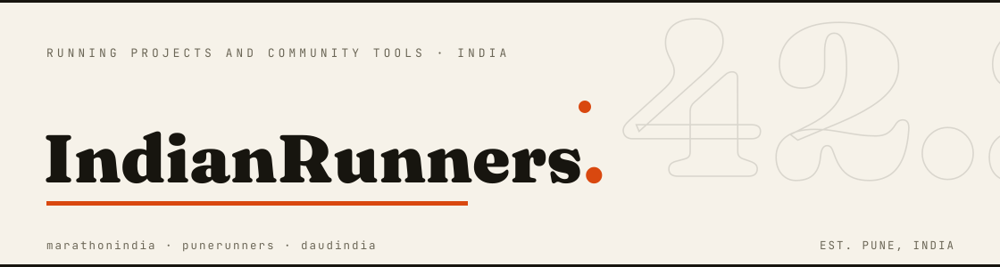

# IndianRunners

Running projects and community tools from India.

| Project | What it is | Live |
| --- | --- | --- |
| **[marathonindia](https://github.com/IndianRunners/marathonindia)** | India's running race calendar. 268 races tracked, refreshed every 8 hours. | [marathonindia.vercel.app](https://marathonindia.vercel.app) |
| **[punerunners](https://github.com/IndianRunners/punerunners)** | Home of the PuneRunners club on GitHub. | [punerunners.com](https://punerunners.com) |
| **[DaudIndia](https://github.com/IndianRunners/DaudIndia)** | Open-source ideas hub: apps, tools and experiments for runners in India. | [ideas](https://github.com/IndianRunners/DaudIndia/issues) |
